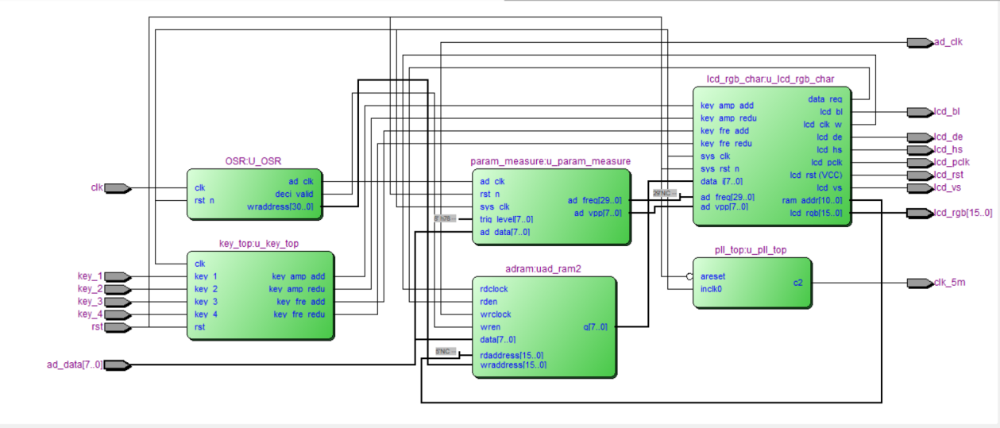
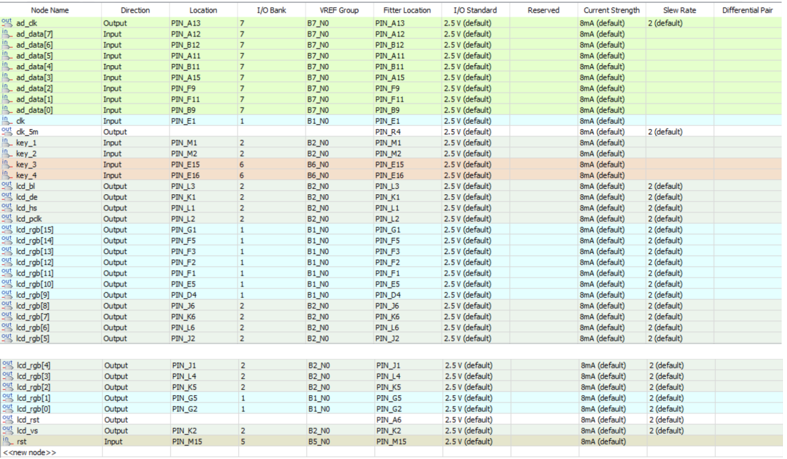
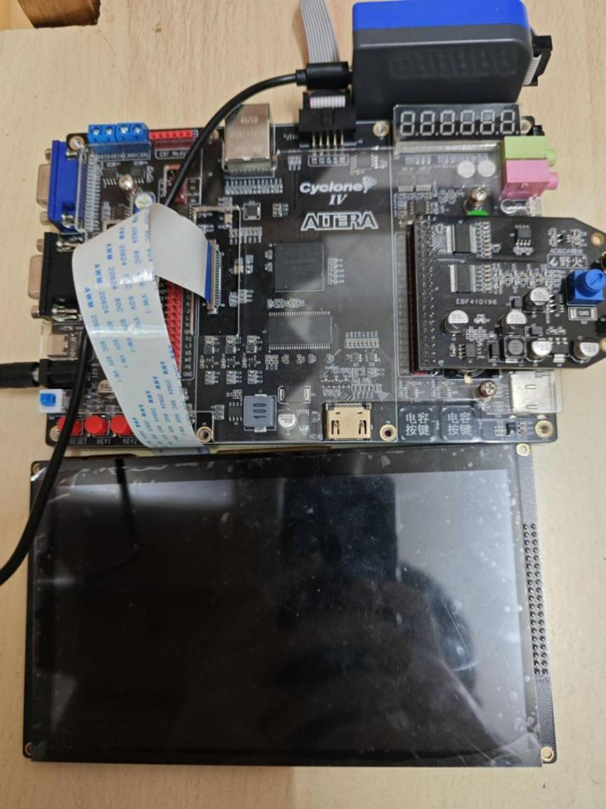
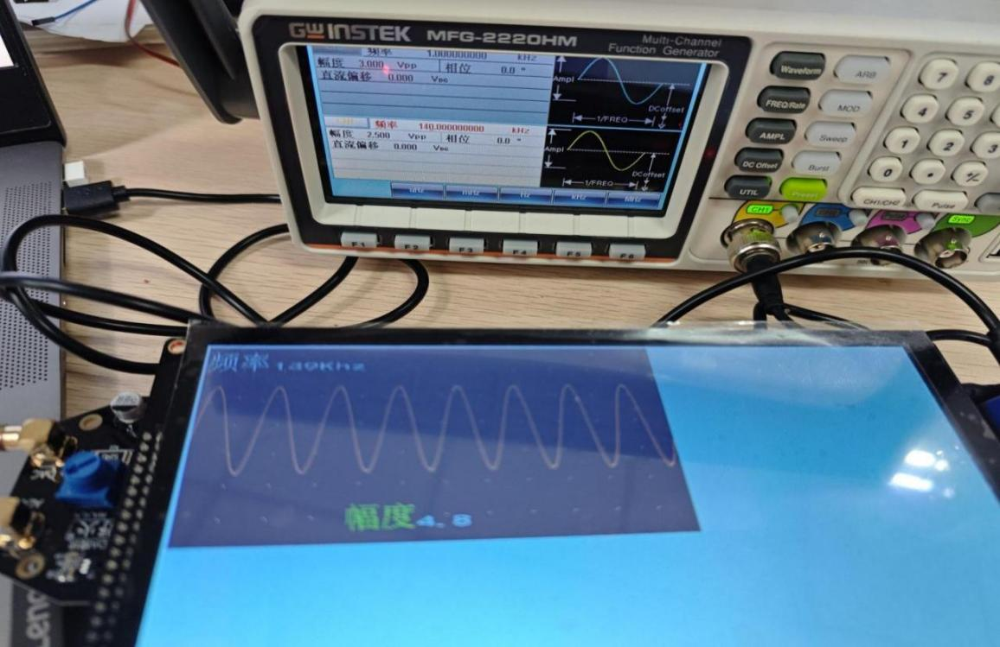

驱动器波形显示

__1）RTL 视图__

将代码在Notepad\+\+书写完成后，并且进行完仿真验证后，如图为quartus软件生成的代码RTL 视图。

图5\.12 RTL 视图

__2）上板准备__

根据开发手册上的板卡芯片引脚分布，对于一些测试信号可以不进行引脚约束而直接悬空。其他关键信号的引脚约束如图所示。开发者需要仔细阅读手册，了解每个引脚的功能，并根据图编写引脚约束文件，确保重要信号连接正确，从而保证系统的稳定性和正常运行。通过合理配置引脚约束，可以有效避免信号干扰和传输错误，提高开发效率和系统性能。

在确认所有连接无误后，可以打开电源开关，为开发板供电。供电后，开发板将开始运行预先下载到其存储器中的程序，执行相应的任务。此时，可以通过TFT\-LCD显示屏观察系统的工作状态，并通过调试工具进行必要的调试和优化。

这种连接和启动过程不仅确保开发板和各个模块能够正常工作，还为后续的调试和功能验证提供了基础。通过确保电源、信号传输和模块连接的正确性，可以有效避免由于连接问题导致的系统故障，从而提高工作效率和系统稳定性。

总之，如图所示的连接步骤是开发板使用过程中的关键环节，通过仔细检查和确认每一个连接点，可以确保系统在上电后能够稳定、可靠地运行，并实现预期的功能和性能。

引脚约束

开发板连接

采集到的波形图像

__3）结果验证__

使用“Programmer”工具将程序下载到开发板后，TFT\_LCD显示屏会显示采集到的波形图像、幅度和频率，如图所示。屏幕能够正常显示用于ADC测试的2kHz至2MHz的正弦波信号。该设计要求完成基于FPGA的TFT屏幕驱动，使屏幕能够准确显示输入波形和测量结果。这确保了系统在信号采集和显示方面的高效性能和准确性，实现了输入信号的实时可视化和数据处理。
